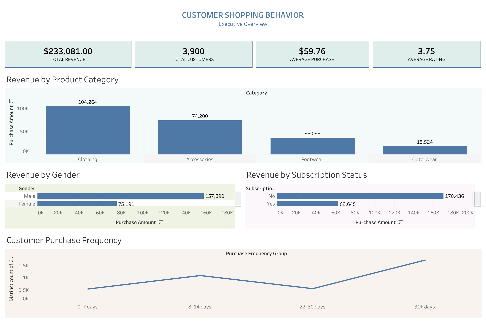

# Customer Shopping Behaviour Analysis

A **guided learning project** following a YouTube tutorial, applying **Python** (data cleaning), **PostgreSQL** (SQL analysis), and **Tableau** (interactive dashboard) to analyse retail transaction data across 3,900 customers.

🔗 **[View the Interactive Tableau Dashboard](https://public.tableau.com/views/CustomerShoppingBehavior_dashboard_FINAL/ExecutiveDashboard)**

---

## 📌 About This Project

This is a **learning project** I completed by following a guided tutorial from **Amlan Mohanty** - a data analytics instructor whose content I've been studying. The dataset, business questions, and overall structure were provided by the tutorial. My work involved:

- Setting up the Python cleaning pipeline
- Writing all 10 SQL queries against a local PostgreSQL database
- Building the Tableau dashboard from scratch
- Interpreting the results and deriving business recommendations

This project was completed as part of my upskilling journey toward data analyst roles.

---

## 🎯 Business Questions Analysed

1. What is the total revenue generated by male vs. female customers?
2. Which customers used a discount but still spent above the average purchase amount?
3. Which are the top 5 products with the highest average review rating?
4. How do average purchase amounts compare between Standard and Express shipping?
5. Do subscribed customers spend more than non-subscribers?
6. Which 5 products have the highest percentage of discounted purchases?
7. How do customers segment into New, Returning, and Loyal based on previous purchases?
8. What are the top 3 most purchased products within each category?
9. Are repeat buyers (>5 previous purchases) more likely to subscribe?
10. What is the revenue contribution of each age group?

---

## 📂 Dataset

| Attribute | Value |
|-----------|-------|
| Source | Provided by the tutorial - originally shared on the instructor's GitHub profile |
| Rows | 3,900 |
| Columns | 19 |
| Missing values | 37 (in `Review Rating`) |
| Features | Demographics, purchase details, subscription, shipping, discounts |

**Data quality note:** The dataset contains a synthetic correlation between `Gender` and `Discount Applied` (all Male customers have discounts; no Female customers do). This is a known quirk of the dataset and limits the generalisability of gender × discount findings.

---

## 🛠️ Tools & Stack

- **Python 3.13** - Pandas, NumPy (data cleaning)
- **PostgreSQL 15** - SQL analysis (10 business questions)
- **SQLAlchemy + psycopg2** - Python-to-PostgreSQL connection
- **Tableau Public** - Interactive dashboard

---

## 🔄 Data Cleaning Pipeline

1. **Missing values** - 37 nulls in `Review Rating` imputed with the **median per Category**
2. **Column standardisation** - snake_case renaming; `Purchase Amount (USD)` → `purchase_amount`
3. **Feature engineering** - created `age_group` (quartile-based) and `purchase_frequency_days`
4. **Redundancy removal** - dropped `promo_code_used` after verifying it duplicated `discount_applied`
5. **Database load** - cleaned dataset pushed to PostgreSQL table `customer` in the `customer_behavior` database

---

## 📊 Key Insights

- **Total Revenue:** $233,081 across 3,900 customers
- **Average Purchase:** $59.76 | **Average Rating:** 3.75
- **Category leader:** Clothing ($104,264) - 45% of total revenue
- **Gender split:** Male ($157,890) vs Female ($75,191) - reflects dataset composition
- **Subscriptions:** Non-subscribers contribute $170,436 vs subscribers $62,645
- **Purchase frequency:** Bimodal - peaks at 0-7 days and 31+ days

---

## 📈 Dashboard Preview



---

## 🚀 How to Reproduce

```bash
git clone https://github.com/97tharusha/customer-shopping-behavior-analysis.git
cd customer-shopping-behavior-analysis
pip install pandas numpy sqlalchemy psycopg2-binary
jupyter notebook notebooks/customer_shopping_behavior_analysis.ipynb
```

---

## 👤 About Me

Hi,I'm Tharusha Fernando. Currently following Masters in IT and Systems(Software Engineering)

I'm an aspiring data analyst based in Melbourne, building skills in **Python**, **SQL**, and **Tableau**. I'm currently looking for junior data analyst opportunities where I can apply my analytical and visualisation skills to real business problems.

🔗 **[LinkedIn](https://www.linkedin.com/in/tharusha-fernando-592878294)**

---
## 📄 License

For educational purposes. Dataset and tutorial content are the property of their original creators.
